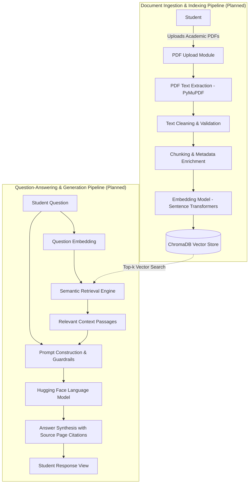

# RAG-Based Student Study Assistant

An intelligent, document-grounded study companion designed to help students query, analyze, and learn from their college syllabi, lecture notes, academic textbooks, and question papers.

---

## 1. Introduction

College students often face information overload when preparing for exams or reviewing coursework. Academic resources—ranging from extensive multi-chapter textbooks and detailed lecture slides to semester syllabi and previous years' question papers—frequently span hundreds of pages. Manually locating syllabus-specific concepts, cross-referencing lecture notes with textbook chapters, or finding answers to targeted revision questions is time-consuming and inefficient.

Standard generative AI systems often struggle in this context because they rely on generalized parametric knowledge, which may hallucinate facts, lack university-specific curriculum alignment, or fail to provide exact page citations.

**Retrieval-Augmented Generation (RAG)** bridges this gap. Instead of relying solely on a language model's pre-trained weights, a RAG system first extracts and indexes the student's study materials. When a question is asked, the system retrieves only the most relevant, context-specific excerpts from those materials and supplies them to the language model as grounded context. This ensures that the generated responses are context-rich, syllabus-aligned, and traceable to original page numbers.

> **Development Status:** This project is being engineered incrementally across structured phases. The current codebase is in early development, establishing fundamental document ingestion routines before integrating retrieval and generation modules.

---

## 2. Project Goals

The core objective of the **RAG-Based Student Study Assistant** is to build a reliable, modular, and privacy-conscious academic assistant. Key milestones and architectural goals include:

- **Academic PDF Processing:** Ingest diverse academic documents, including lecture handouts, standard textbooks, and syllabus outlines.
- **Accurate Text and Metadata Extraction:** Extract clean text while rigorously preserving page numbers and document titles for source attribution.
- **Semantic Document Chunking:** Split lengthy academic texts into logical, overlapping segments that preserve conceptual continuity without exceeding token constraints.
- **Embedding Generation:** Convert text chunks into high-dimensional semantic representations using lightweight, domain-effective embedding models.
- **Vector Storage and Fast Indexing:** Store vector representations and chunk metadata locally using ChromaDB for persistent, efficient similarity search.
- **Grounded Answer Synthesis:** Use pre-trained Hugging Face language models to generate concise, student-friendly answers based strictly on retrieved context.
- **Verifiable Citations and Hallucination Fallbacks:** Provide clear source-page references for every answer and explicitly state when a question cannot be answered from the supplied materials.
- **Future Academic Modules:** Progressively integrate features such as multi-document summaries, exam revision flashcards, automated quiz generation, and syllabus-mapped revision planners.

---

## 3. Planned Features

The feature roadmap is organized in development order. All features listed below are **planned** and will be implemented incrementally:

1. **PDF Text Extraction and Validation:** Robust document reading, structure verification, and handling of blank or corrupted pages. *(Planned / In Progress)*
2. **Text Chunking and Metadata Management:** Sentence-aware recursive splitting with associated document title and page metadata. *(Planned)*
3. **Embedding Generation:** Local vectorization using open-source Sentence Transformers. *(Planned)*
4. **ChromaDB Vector Storage:** Persistent local vector indexing with metadata filtering. *(Planned)*
5. **Semantic Retrieval:** Top-$k$ similarity search with distance thresholds to find relevant academic passages. *(Planned)*
6. **Grounded Answer Generation:** Strict prompt engineering with Hugging Face language models to restrict generation to retrieved context. *(Planned)*
7. **Source-Page References:** Explicit citations referencing document names and exact page numbers accompanying each response. *(Planned)*
8. **Student-Friendly Explanations and Summaries:** Configurable explanation modes (e.g., beginner-friendly, bullet-point summary, technical breakdown). *(Planned)*
9. **Quiz Generation and Exam Preparation:** Automatic creation of multiple-choice and conceptual review questions from selected document chapters. *(Planned)*
10. **Study Planning and Progress Tracking:** Topic-based revision scheduling mapped to syllabus sections. *(Planned)*
11. **Interactive Web Interface:** A clean, responsive Streamlit dashboard for uploading documents, browsing citations, and interactive querying. *(Planned)*

---

## 4. Technology Stack

The project leverages modern open-source Python libraries tailored for modular AI development:

| Component | Technology | Intended Role & Purpose |
| :--- | :--- | :--- |
| **Language & Runtime** | Python 3.10+ | Core application logic, data structures, and pipeline orchestration. |
| **Document Ingestion** | PyMuPDF (`fitz`) | High-speed PDF parsing and page-by-page text extraction with layout preservation. |
| **Embedding Model** | Sentence Transformers | Computes dense vector embeddings to capture academic semantics. |
| **Vector Store** | ChromaDB | Open-source, embeddable vector database for local storage, persistence, and nearest-neighbor search. |
| **Language Model** | Hugging Face Transformers | Local or pipeline-hosted open-source language models for context-grounded response generation. |
| **User Interface** | Streamlit | Planned lightweight web interface for drag-and-drop PDF uploads and chat-based Q&A. |
| **Test Suite** | Pytest | Automated unit and integration testing across extraction, chunking, and retrieval logic. |
| **Version Control** | Git & GitHub | Source control, issue tracking, and incremental phase documentation. |

*Note: Technologies listed above represent the planned architecture. Packages are introduced and installed as their respective phases are reached.*

---

## 5. Architecture Diagram

The system separates document ingestion (indexing) from student question-answering (inference) to ensure fast query latency and modular data pipelines.

### Planned Architecture Flowchart



---

## 6. Architecture Explanation

The planned architecture is divided into two distinct pipelines:

### 1. Document Indexing Pipeline
- **Document Ingestion:** The student provides PDF documents (such as textbook chapters, lecture slides, or syllabus guidelines).
- **Text Extraction:** PyMuPDF parses the raw document streams, extracting clean text while capturing critical document metadata (filename, page numbers, total pages).
- **Text Cleaning and Validation:** Basic sanitization removes artifacts, excessive whitespace, and verifies that the document contains extractable text.
- **Chunking and Metadata Management:** Because language models have finite context windows, large texts are divided into overlapping chunks (e.g., 500 tokens with a 50-token overlap). Each chunk retains metadata indicating its parent document and page origin.
- **Embedding Generation:** Each text chunk is converted into an embedding vector using a Sentence Transformer model, positioning semantically similar concepts close together in vector space.
- **Vector Storage:** Embeddings and chunk payloads are written to ChromaDB, enabling persistent indexing and rapid retrieval.

### 2. Question-Answering Pipeline
- **Query Embedding:** When a student enters a question, the query string is converted into a vector using the same embedding model.
- **Semantic Retrieval:** ChromaDB computes similarity metrics (e.g., cosine similarity) to identify the top-$k$ most relevant text chunks.
- **Context Construction:** The retrieved chunks are formatted with their page identifiers into a structured prompt with instructions for the language model.
- **Answer Generation:** A Hugging Face language model processes the prompt and produces an answer.
- **Source-Grounded Responses:** Responses cite exact page numbers. If the retrieved context does not contain sufficient information to answer the question, the system falls back gracefully rather than hallucinating an ungrounded response.

---

## 7. Project Structure

The planned repository layout is designed for clarity, testability, and progressive enhancement:

```text
rag-study-assistant/
├── README.md
├── requirements.txt
├── .gitignore
├── pytest.ini
├── src/
│   ├── chunking.py
│   ├── demo_pdf.py
│   ├── demo_pdf_rag.py
│   ├── demo_retrieval.py
│   ├── embeddings.py
│   ├── pdf_loader.py
│   └── retrieval.py
├── tests/
│   ├── test_chunking.py
│   ├── test_embeddings.py
│   ├── test_pdf_loader.py
│   └── test_retrieval.py
├── data/
│   └── .gitkeep
└── docs/
    └── architecture.md
```

> **Note:** This represents the intended project structure. Files and directories will be created systematically as each development phase commences.

---

## 8. Development Roadmap

The project follows a phased engineering roadmap to verify each component independently before end-to-end integration:

| Phase | Focus Area | Key Deliverables | Status |
| :---: | :--- | :--- | :---: |
| **Phase 1** | Foundation & PDF Extraction | Project setup, PyMuPDF extraction module, input validation, and unit tests. | Completed |
| **Phase 2** | Chunking & Embeddings | Recursive text chunking, metadata attachment, and Sentence Transformer integration. | Completed |
| **Phase 3** | Vector Storage | ChromaDB collection initialization, local persistence, and indexing operations. | In Progress |
| **Phase 4** | Semantic Retrieval | Similarity search, distance threshold tuning, and retrieval relevance evaluation. | Completed |
| **Phase 5** | Model Integration & Grounding | Hugging Face LLM prompt assembly, grounded answer generation, and citation formatting. | Planned |
| **Phase 6** | UI & Error Handling | Streamlit web application, file uploader, chat history, and gracefully handled edge cases. | Planned |
| **Phase 7** | Evaluation & Portfolio Polish | Systematic evaluation, latency benchmarking, complete documentation, and portfolio showcase. | Planned |
| **Future** | Advanced Study Utilities | Automated quiz generation, exam answer structuring, multi-page summarization, and study planners. | Planned |

---

## 9. Getting Started

Setup instructions are provided below using Windows PowerShell. Note that environment requirements will expand as dependencies are added in subsequent phases.

### 1. Clone the Repository
```powershell
git clone https://github.com/sulaimanshaik008-collab/RAG-study-assistant.git
cd RAG-study-assistant
```

### 2. Create and Activate a Virtual Environment
```powershell
# Create virtual environment
python -m venv venv

# Activate virtual environment (Windows PowerShell)
.\venv\Scripts\Activate.ps1
```

> *Tip: If you encounter an execution policy warning in PowerShell, you may run `Set-ExecutionPolicy -ExecutionPolicy RemoteSigned -Scope Process` before activation.*

### 3. Install Dependencies
```powershell
# Dependencies will be specified in requirements.txt during implementation phases
python -m pip install --upgrade pip
pip install -r requirements.txt
```

*(Installation requirements will be populated as corresponding project phases are executed.)*

---

## 10. Testing

Automated testing is integrated using Pytest to validate extraction accuracy, chunk integrity, and edge case resilience.

To run the test suite:
```powershell
python -m pytest -v
```

> **Note:** Automated test commands will only execute successfully once the test suite and corresponding source modules are implemented in subsequent phases.

---

## 11. Evaluation Strategy

To ensure educational utility and factual precision, the application will be measured against specific quantitative and qualitative benchmarks:

- **PDF Extraction Success:** Percentage of supported documents parsed without text corruption, structural degradation, or missing pages.
- **Retrieval Recall@5:** Frequency with which the gold-standard source passage is included within the top-5 retrieved chunks for a test question set.
- **Answer Correctness:** Qualitative and semantic alignment of synthesized answers against academic source ground truth.
- **Evidence Grounding:** Verification that generated responses contain only claims backed by the retrieved text, minimizing hallucinations.
- **Citation Accuracy:** Exact match frequency between cited page numbers and the physical pages where information resides.
- **Indexing and Response Latency:** Measured wall-clock time for document embedding generation and per-query answer generation.

*(Benchmarks and evaluation scripts will be documented upon system completion; no performance figures are assumed or fabricated prior to empirical testing.)*

---

## 12. Limitations

Users and developers should keep in mind the following current technical limitations:

- **Scanned and Image-Only PDFs:** Pure image scans cannot be read via standard text extraction and will require Optical Character Recognition (OCR) tooling in future revisions.
- **Complex Formats and Layouts:** Mathematical formulas, multi-column research papers, tables, and charts may yield imperfect text representations.
- **Model Hallucinations and Errors:** Generative models may misinterpret subtle academic nuances or synthesize plausible-sounding inaccuracies.
- **Retrieval Sensitivity:** Retrieval precision depends heavily on chunk boundaries, embedding quality, and query phrasing.
- **Verification Requirement:** Because this tool aids academic study, answers and page citations should always be verified against the original syllabus or textbook before exam submission.

---

## 13. Security and Responsible Use

- **Data Privacy:** Do not upload sensitive institutional materials, confidential student records, or personally identifiable information (PII) to shared environments or public repositories.
- **Credential Protection:** Never commit API keys, authentication tokens, or environment files (`.env`) to version control.
- **Artifact Management:** Local vector database folders, downloaded model weights, and sample academic PDFs must be added to `.gitignore` to prevent repository bloat and unintended data leakage.

---

## 14. Learning Objectives

This project serves as a hands-on foundation in applied AI engineering, covering:

- **RAG Architecture Fundamentals:** Understanding the interplay between indexing, retrieval, and generation.
- **Tokenization and Context Constraints:** Managing text chunks to prevent context-window overflow and truncation artifacts.
- **Semantic Vector Spaces:** Exploring how embedding models represent thematic and lexical relationships in text.
- **Vector Database Operations:** Indexing, updating, and querying high-dimensional vectors with ChromaDB.
- **Prompt Engineering & Grounding:** Structuring model prompts to constrain generation to verifiable reference materials.
- **Retrieval Evaluation:** Developing methodologies to assess recall, precision, and citation validity.
- **Testing & Quality Assurance:** Writing maintainable unit tests for parsing, chunking, and pipeline orchestration.

---

## 15. License

The license for this project has not yet been selected. All rights are reserved by default until an appropriate license is determined and added.